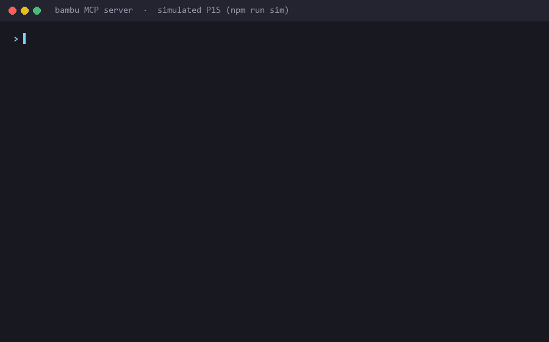

# mcp-server-for-bambu

[](https://www.npmjs.com/package/mcp-server-for-bambu)
[](https://github.com/b84330808/mcp-server-for-bambu/actions/workflows/ci.yml)
[](LICENSE)

**Ask Claude (or Cursor, or VS Code) what your Bambu Lab printer is doing, and have it pause, preheat or log maintenance, over your LAN with no cloud.**

An MCP server for Bambu Lab 3D printers. It talks to the printer directly over its local MQTT interface. Built and tested against the **P1S**; other MQTT-speaking models (P1P, X1C, A1) should work.

> **⚠️ Unofficial — not affiliated with Bambu Lab**
>
> This is a community-built project. It is **not affiliated with, endorsed by, or sponsored by Bambu Lab / Shenzhen Tuozhu Technology Co., Ltd.** "Bambu Lab", "Bambu Studio", "P1S", "P1P", "X1C", and "AMS" are trademarks of their respective owners; references in this project are descriptive only (nominative fair use), made for compatibility purposes. Provided "as is" with no warranty.

## Demo

<!--
  DEMO GIF PLACEHOLDER
  Record it with docs/demo-script.md, save it as docs/demo.gif, then replace
  this comment with:
  
-->

*Demo GIF coming soon. [docs/demo-script.md](docs/demo-script.md) has the recording script.*

## Features

| | |
| --- | --- |
| **Live status** | State, current stage, progress, layer, time left, nozzle/bed/chamber temperatures, Wi-Fi signal |
| **AMS** | Filament type, brand, color and remaining % per slot, plus the active slot |
| **Health** | Active HMS warnings decoded to module and severity, each with its Bambu wiki link |
| **Control** | Pause, resume, cancel, chamber light, speed profile, preheat, AMS slot switch, raw G-code |
| **Maintenance ledger** | Counts print-hours locally and tells you when rails, carbon rods or the hotend are due |
| **Guided setup** | No config editing: tell Claude your IP, serial and access code; it tests them before saving |
| **Safety** | Cancel, G-code and AMS switch need explicit confirmation; read-only mode; LAN addresses only |
| **Works anywhere MCP does** | Claude Code plugin, Claude Desktop, Cursor, VS Code, any stdio MCP client |
| **Printer simulator** | `npm run sim` starts a fake printer for trying it out, demos and tests |

## Quick start

You need Node.js 20+ and a printer on the same network with **LAN Mode Liveview** turned on.

### Claude Code

Install the plugin (MCP server plus a short skill that teaches Claude the confirmation rules):

```
/plugin marketplace add b84330808/mcp-server-for-bambu
/plugin install bambu-printer@mcp-server-for-bambu
```

Or add just the MCP server:

```bash
claude mcp add --transport stdio --scope user bambu -- npx -y mcp-server-for-bambu
```

### Claude Desktop

Open **Settings → Developer → Edit Config** (`%APPDATA%\Claude\claude_desktop_config.json` on Windows, `~/Library/Application Support/Claude/claude_desktop_config.json` on macOS) and add:

```json
{
  "mcpServers": {
    "bambu": {
      "command": "npx",
      "args": ["-y", "mcp-server-for-bambu"]
    }
  }
}
```

Fully quit Claude Desktop (tray icon → Quit) and reopen it.

### Cursor

[](https://cursor.com/install-mcp?name=bambu&config=eyJjb21tYW5kIjoibnB4IiwiYXJncyI6WyIteSIsIm1jcC1zZXJ2ZXItZm9yLWJhbWJ1Il19)

Or put this in `~/.cursor/mcp.json` (all projects) or `.cursor/mcp.json` (one project):

```json
{
  "mcpServers": {
    "bambu": {
      "command": "npx",
      "args": ["-y", "mcp-server-for-bambu"]
    }
  }
}
```

### VS Code

```bash
code --add-mcp "{\"name\":\"bambu\",\"type\":\"stdio\",\"command\":\"npx\",\"args\":[\"-y\",\"mcp-server-for-bambu\"]}"
```

Or add it to `.vscode/mcp.json`. This version passes the credentials as env vars and asks for the access code as a hidden input:

```json
{
  "inputs": [
    {
      "type": "promptString",
      "id": "bambu-access-code",
      "description": "Bambu LAN access code (Settings > WLAN > LAN Mode Liveview)",
      "password": true
    }
  ],
  "servers": {
    "bambu": {
      "type": "stdio",
      "command": "npx",
      "args": ["-y", "mcp-server-for-bambu"],
      "env": {
        "BAMBU_IP": "192.168.1.50",
        "BAMBU_SERIAL": "01P00A1234567890",
        "BAMBU_ACCESS_CODE": "${input:bambu-access-code}"
      }
    }
  }
}
```

All of these are in [`examples/`](examples/).

### Connect your printer

On first start the server is in **setup mode** and offers one tool, `setup_printer`. Read three values off the printer's touchscreen:

- **IP**: `Settings → WLAN →` tap the connected network
- **Serial**: `Settings → Device → Device Info` (P1S: `01P00A…`)
- **Access code**: `Settings → WLAN → LAN Mode Liveview`, 8 characters, **not** the Wi-Fi password. LAN Mode Liveview must be ON.

Then tell your assistant:

> "Set up my Bambu printer. IP is 192.168.1.50, serial 01P00A1234567890, access code 12345678."

`setup_printer` checks the format, connects to the printer, and **saves the credentials only if the connection works**. Restart the server once (Claude Desktop: quit and reopen; Claude Code: `/mcp` → reconnect `bambu`) and the printer tools appear.

You can skip this and pass `BAMBU_IP`, `BAMBU_SERIAL` and `BAMBU_ACCESS_CODE` as env vars instead, as in the VS Code example.

### Try it

- "What's my printer doing right now?"
- "What filament is in AMS slot 2?"
- "Any HMS warnings?"
- "Anything overdue on the printer maintenance?"
- "Pause the print." / "Resume."
- "Preheat the nozzle to 210 and bed to 60."
- "Cancel this print." (asks you to confirm first)
- "I just lubricated the rails, log it."

## Tools

| Tool | What it does | Asks first? |
| --- | --- | --- |
| `get_status` | State, stage, temperatures, progress, layer, HMS warnings, Wi-Fi | |
| `get_ams_info` | Per-slot filament type / color / remaining %, active slot | |
| `list_active_warnings` | Active HMS warnings with links to Bambu's wiki | |
| `get_maintenance_status` | Print-hours and lube / clean / inspect warnings | |
| `forecast_maintenance` | When each maintenance task will be due at your recent print rate | |
| `get_recent_prints` | Last N print sessions: name, duration, finish time | |
| `mark_maintenance_done` | Log a maintenance task (optionally back-dated by `hours_ago`) | |
| `pause_print` / `resume_print` | Pause and resume the current print | |
| `set_light` | Chamber light on/off | |
| `set_speed` | silent / standard / sport / ludicrous | |
| `preheat` | Set nozzle and/or bed target temperature | |
| `stop_print` | Cancel the print. Not reversible | **yes** (`confirm: true`) |
| `run_gcode` | Send raw G-code (homing, Z moves, manual unload…) | **yes** (`confirm: true`) |
| `change_active_tray` | Switch the AMS to another slot | **yes** (`confirm: true`) |

Every tool also carries MCP annotations (`readOnlyHint`, `destructiveHint`), so clients that ask before running tools can treat the read tools and the destructive ones differently.

## Safety

This server can move a heated toolhead and cancel hours of printing. It is built to make that hard to do by accident:

- **Confirmation for destructive tools.** `stop_print`, `run_gcode` and `change_active_tray` refuse to run unless called with `confirm: true`, and their descriptions tell the model to set it only after you agree in plain words. Keep your client's own tool-approval prompts on as a second check.
- **Read-only mode.** Set `BAMBU_READ_ONLY=1` and the server registers only the read tools. Nothing can pause, cancel, heat or move the printer. A good default for a shared machine or a demo.
- **LAN only.** It connects to the one printer IP you configure, on port 8883, and nowhere else: no Bambu cloud, no telemetry. `setup_printer` rejects addresses outside private ranges (192.168.x.x, 10.x.x.x, 172.16–31.x.x, plus link-local, loopback and the 100.64/10 range Tailscale uses). Never forward the printer's MQTT port to the internet.
- **Trusted network.** The printer uses a self-signed certificate, so the connection is encrypted but the printer's identity is not verified. Use it on a network you trust.
- **Heaters stay on.** `preheat` and `M104`/`M140` leave the heaters at the target until something changes them. Turn them off (set 0) before you walk away.
- **Credentials stay local.** They are stored in your user config directory (below), with owner-only permissions on macOS and Linux.

## Configuration

| Env var | Default | Meaning |
| --- | --- | --- |
| `BAMBU_IP`, `BAMBU_SERIAL`, `BAMBU_ACCESS_CODE` | from the saved `.env` | Printer credentials. Env vars win over the saved file |
| `BAMBU_READ_ONLY` | `0` | `1` registers only the read tools |
| `BAMBU_CONFIG_DIR` | see below | Where the `.env` and the maintenance ledger live |
| `MAINTENANCE_LEDGER_PATH` | `<config dir>/maintenance.json` | Ledger file location |

The config directory is:

- **Windows**: `%APPDATA%\mcp-server-for-bambu\`
- **macOS**: `~/Library/Application Support/mcp-server-for-bambu/`
- **Linux**: `~/.config/mcp-server-for-bambu/` (or `$XDG_CONFIG_HOME`)

Versions up to 0.2.0 kept `.env` and `maintenance.json` inside the installed package, where `npx` updates could delete them. 0.3.0 still reads an old `.env` from there and copies an old ledger into the config directory on first start.

The ledger persists to a local JSON file and survives crashes (active sessions are checkpointed every 5 elapsed minutes). Thresholds are in `src/types.ts`:

| Task | Interval |
| --- | --- |
| Clean carbon rods | 100 print-hours |
| Lubricate linear rails | 200 print-hours |
| Inspect hotend / nozzle wear | 500 print-hours |

A task flips to `DUE_SOON` (🔔) within 10 hours of the threshold and `OVERDUE` (⚠️) past it.

## Try it without a printer

`npm run sim` (from a clone, after `npm install`) starts a simulated P1S halfway through a Benchy, with a 4-slot AMS, on `mqtts://127.0.0.1:8883`. It answers status requests and applies pause, resume, cancel, speed, preheat, light and AMS commands. Point the server at it:

```bash
BAMBU_IP=127.0.0.1 BAMBU_SERIAL=01P00ASIMULATOR BAMBU_ACCESS_CODE=12345678 node dist/index.js
```

Set `SIM_PORT` to use another port, then pass the same value as `BAMBU_MQTT_PORT`. The test suite uses the same simulator.

## Development

```bash
git clone https://github.com/b84330808/mcp-server-for-bambu.git
cd mcp-server-for-bambu
npm install
npm test             # builds, then runs unit + end-to-end tests against the simulator
npm run dev          # tsc --watch
npm run sim          # simulated printer
```

To run your local build from an MCP client, point it at `node /absolute/path/to/mcp-server-for-bambu/dist/index.js`.

```
src/
  index.ts          MCP server bootstrap + tool definitions
  config.ts         Env / .env loading, LAN address check
  paths.ts          Per-user config directory
  mqtt-client.ts    TLS MQTT client for the printer (port 8883, self-signed cert)
  setup.ts          setup_printer: validate, test the connection, save
  maintenance.ts    Print-time ledger with crash-safe atomic writes + recovery
  hms.ts            Bambu HMS error code → human label
  stages.ts         Stage / speed / tray code → human label
  commands.ts       MQTT command payloads
sim/printer.mjs     Simulated printer (aedes broker over TLS)
plugins/            Claude Code plugin; .claude-plugin/marketplace.json lists it
server.json         MCP Registry metadata
```

**Protocol notes:**
- Subscribe: `device/{serial}/report`
- Publish: `device/{serial}/request` with `{"pushing":{"sequence_id":"...","command":"pushall"}}`
- Auth: username `bblp`, password = access code, a random client ID per connection (reusing one makes two clients kick each other off)
- Cert is self-signed → `rejectUnauthorized: false`

## License

MIT

<!-- mcp-name: io.github.b84330808/mcp-server-for-bambu -->
